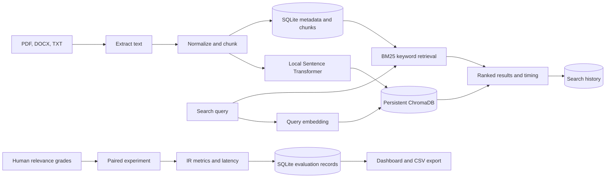

# Architecture

Semantic Search Studio uses Streamlit for the interface. `ui/` contains shared presentation components and styling, `services/search_service.py` coordinates retrieval and timing, and `core/` contains the retrieval and document-processing engines. `core/document_processor.py` extracts page-level PDF text via PyMuPDF, paragraphs/tables from DOCX, and UTF-8 text from TXT. The chunker normalizes whitespace and groups sentence units into word-count windows; oversized sentences are windowed. SQLite stores document/chunk records and experiment judgments. ChromaDB separately stores text, metadata, and normalized embeddings in a persistent cosine-distance collection. Sentence Transformers loads lazily on first inference; the default `all-MiniLM-L6-v2` model produces 384 dimensions. BM25 ranks the same SQLite chunk set used to index the vector collection.

Upload processing writes vectors before marking the SQLite document indexed; failed ingestion attempts remove partial vector records and database records. Document deletion removes its Chroma records and cascades SQLite chunks/judgments. Since SQLite and Chroma are separate stores, they cannot share one atomic transaction; the UI cleanup handles ordinary failures but abrupt process termination can require re-indexing/deleting the document.

The Streamlit workspace sections are overview, upload/library, each search method, paired comparison, evaluation, history, and settings. Evaluation configurations and scores are persisted in SQLite alongside queries and judgments. Each experiment records retrieval-only and end-to-end timing, repeated-run standard deviations, and judgment coverage. Runtime files live under `data/`; they are excluded from version control.

## Retrieval timing

Retrieval-only latency measures BM25 scoring or the Chroma query. End-to-end query latency measures BM25 index construction plus scoring, or semantic query embedding plus Chroma retrieval. Model initialization and shared SQLite chunk loading are excluded from both. Evaluation repeats each scope the configured number of times (default 3) and reports mean/standard deviation. Document indexing time is not an online query metric and is not included. These scopes are named in the UI and exports.
